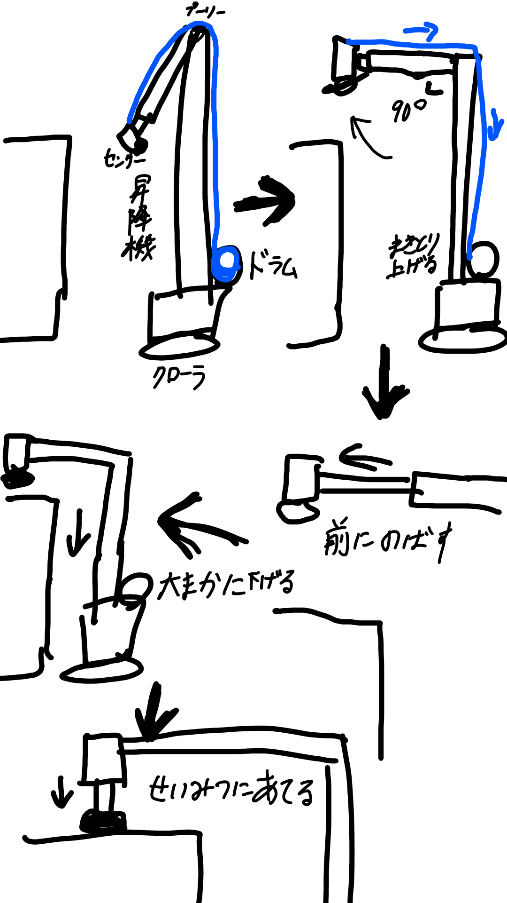

# 測定機構の案（検討メモ）

**spec ではない。**ユーザーが示した「いま考えている機構」の記録。
決まったものから [Spec.md](spec/Spec.md)・[Spec-open.md](spec/Spec-open.md) へ移す。

> **2026-10-31: 機構の設計は未定**（下は 1 つの案）。**できることは決まり、[Spec.md](spec/Spec.md) §1.3 へ移した**:
> 昇降機に取り付き、昇降機と一緒に上下する。測定器を前後に動かせる。左右には動けない。

> **機構は開発中で、構成機器（サーボ・ボールネジ等）は変わりうる**（2026-10-30 ユーザー。`FD-6`）。
> 詳細設計では機器ごとの違いを薄い層に閉じ込め、機器を替えても判定ロジックと画面を作り直さずに済むようにする。

## 結論（2026-11-01 の仮の構成）

**昇降機の上端を支点に腕を水平まで起こし、前へ伸ばして天面の上に出す。昇降機で大まかに下げてから、腕の先で測定器を精密に当てる。**
（2026-11-01 にユーザーが示した。**まだ仮**）

> **2026-11-04（ユーザー）: 測定機構の変更で、配電盤に対して 90° 旋回してから腕を展開し、もう一度 90° 旋回して向きを合わせないと、腕が盤に当たることが分かった。**
> 格納も 90° 旋回してから・お立会試験でも本システムが旋回を指示し、戻す旋回で天面の中央へ向きを合わせる・左右は腕が振れる範囲が空いている側を選ぶ、が同日に決まり、[Spec-arm.md](spec/Spec-arm.md) と下の段の表に入れた。

| 部分 | 中身 |
| --- | --- |
| 腕 | 昇降機の上端（プーリーのところ）を支点に回る。前に伸びる |
| ドラム | **腕を起こす専用で、機体側に付く**（昇降しない）。線は昇降機に沿って上がり、上端のプーリーを越えて腕の先へ張る。**制御は昇降機の ESP32（hve-system の昇降部）が行う**（2026-11-01 ユーザー決定）。**昇降機の ESP32 のシールド基板のコネクタでつなぐ**（2026-11-02 ユーザー決定） |
| 水平の保持 | ストッパーとリミットスイッチで 90° を保つ（2026-11-01）。**腕はストッパーに接触しない位置に保つ。腕の角度はロータリポテンショメータで測り、アームの ESP32 のアナログピンにつなぐ**（2026-11-02 ユーザー決定。ストッパーに当たったまま線が張り続けると腕や線を傷めるため） |
| 前へ伸ばす | **モーターとボールねじ**（詳しくは未定） |
| 先端の上下 | **ボールねじ**（ストロークは未定） |
| アームの ESP32 | **腕の根元に置く。腕を伸ばす・先端の上下・格納位置／展開位置のリミットスイッチを持つ**（2026-11-01 ユーザー決定）。**カメラモジュールと同様に無線と電池**（2026-11-02 ユーザー決定）。格納位置／展開位置のリミットスイッチと腕の角度（ロータリポテンショメータ）は**ドラムのフィードバック**も担う（ドラムのエンコーダは検討中）。腕が格納位置にないかを昇降部へ知らせる（2026-11-02） |

| 段 | 動き | 使うもの |
| --- | --- | --- |
| 1. 収納 | 腕は支点から斜め下に垂れて格納される。**機体より前には出ない** | — |
| 2. 昇降機を上げる | **腕を起こす前に上げる** | 昇降機（hve-system） |
| 3. 腕を起こす | **盤に対して 90° 旋回した向きで**（段 2 との順は決めていない）、ドラムで線を巻き取り、腕を 90°（水平）まで起こす。起こしたら腕を十分に上げ、**90° 戻して向きを合わせる**（2026-11-04 ユーザー決定。盤に向いたまま起こすと盤に当たる）。**本システムが別に指示する**（格納と同じ） | クローラ（th-system）・ドラム・昇降機 |
| 4. 前に伸ばす | 測定器を天面の上へ出す | 腕のボールねじ |
| 5. 大まかに下げる | 測定器を天面の近くまで下げる | 昇降機（hve-system） |
| 6. 精密に当てる | 測定器を天面へまっすぐ下ろして当てる（最終アプローチ。[Spec-open.md](spec/Spec-open.md) `FK-A5`） | 先端のボールねじ |
| 7. 伸びを戻す | 先端を上げ、腕の伸びを戻す（腕は起きたまま。th-system の言う「測定機構を引いた」はこれではなく段 8 のあと）。**アームの ESP32 に任せるのはここまで**（2026-11-02 ユーザー決定）。この状態なら、腕を起こしたまま盤前で旋回してよい（**旋回の前に毎回、昇降機で腕を十分に上げて当たらないようにする。並進は格納してから**。2026-11-02 ユーザー決定。上げられなければ旋回しない。格納も旋回してからなので、盤に向いたままなら止めて人が判断する。2026-11-04） | 先端・腕のボールねじ |
| 8. 格納 | 腕を十分に上げてから**盤に対して 90° 旋回し**（2026-11-04 ユーザー決定。盤に向いたまま下ろすと盤に当たる）、腕を格納位置へ下ろす。**本システムが別に指示する**（アームの ESP32 に指示し、アームの ESP32 がドラムを昇降部に命じる。2026-11-02 ユーザー決定）。お立会試験の「測定を終えた」はこのあと（2026-11-02 ユーザー決定） | クローラ（th-system）・ドラム |

**ドラムは機体側にあるので、昇降機が動くとき（上げるときも下げるときも）と腕を伸ばすときは、それに合わせてドラムを動かす必要がある**（2026-11-01 ユーザー）。昇降機に合わせるのは昇降部の ESP32 なので、本システム・ss-system・人のどれが昇降機を動かしてもドラムはついていく。

**制御の分担は決まり、[Spec-arm.md](spec/Spec-arm.md) へ移した**（2026-11-01）: 本システムの指示で、アームが主導してドラムと昇降機を動かす。測定機構が付いていることを検知し、付いているときはアームの ESP32 と昇降機の ESP32 が通信する（検知しているのに通信できないときは昇降機を動かさない。下げることもせず、物理ボタンも同じ。異常を解消して通信を戻してから下ろす。直せないときは、人がアームの安全を判断し、コネクタを抜くかも人が決める。起動中にコネクタの状態が変わったら、昇降部の画面に確認ダイアログを出す。ソフトウェアが関わるのは確認ダイアログだけ）。**測るときは、必要な情報をアームの ESP32 に渡し、測定完了まで任せる（クローラで向きを合わせてから。お立会試験も同じ。2026-11-04）。それ以外の昇降機の操作は昇降機の ESP32 へ直接送る。天井の距離・上限・下限は昇降機の ESP32 が拒否して守る。昇降機が引っかかったときは、アームの格納位置・展開位置の検知がドラムの制御に要る情報を与える。**

前の案（2026-10-30）は、腕の下端を支点に上端を前へ倒す跳ね橋で、先端のサーボで垂直を保ちボールネジで押し出す形だった（[スケッチ](source/measure-arm-sketch-2026-10-30.jpg)）。

## 決まっていないこと

| 問い | 関係 |
| --- | --- |
| アームの ESP32 に渡す「必要な情報」の中身と、どうつなぐか（任せる範囲は段 7 までと 2026-11-02 に決定） | `FK-A5` |
| 腕を伸ばす長さ、先端のストローク | `FK-V1` |
| 腕・ドラムをどう取り付けるか | `FK-A5` |
| hve-system が答えを待っているもの: 昇降機が引っかかったとき・制御器どうしの取り決め（腕の角度の渡し方を含む）・遅れたとみなす腕の角度のずれ・腕を起こしたときの最も高い所（線の取り回し・コネクタ・線が張る側の検知・ドラムが遅れたときの止め方・電源断でドラムを保つこと・確認ダイアログ・原点取り（腕を格納してから下げる）・格納のドラム（アームの ESP32 が命じる）は 2026-11-02 に決定） | [Spec-open.md](spec/Spec-open.md) §1.3・`FK-A5` |
| 接触したことをどう検知するか（モックアップでも要る）、どれだけの力で押すか | `FK-X4`・`FK-V3` |
| アームの ESP32 が止まった（電池切れ・無線の途切れ）とき、腕の伸びと先端がどうなるか（通信断・電源断の残り。確認ダイアログと原点取りは 2026-11-02 に決定） | `FK-X5` |
| 90° 旋回して腕を起こす・格納することの残り（2026-11-04）: 腕が振れる横の範囲が空いていることをどう確かめるか、格納して旋回したあと盤へ向きを戻すか（格納も旋回してから・お立会試験でも本システムが旋回を指示する・左右は空いている側を選ぶ、は 2026-11-04 に決定） | `FK-X7` |
| 腕を起こしたまま旋回するとき（段 7）、腕をどれだけ上げれば十分か（毎回昇降機で上げる・並進は格納してから、は 2026-11-02 に決定。上げられなければ止めて人が判断する、は 2026-11-04） | `FK-X7` |

## 次にやること

1. ~~hve-system への申し送り（[Spec-open.md](spec/Spec-open.md) §1.2）を、測定機構がもう少し固まってから送る~~（2026-11-01 送付。hve `a9dc936` で反映済み）
2. `FK-A5` の残り（取り付け方・アームに渡す情報）を決める
3. モックアップの概形（寸法）と接触の検知の方法を決める
4. 天面の高さ・届く距離・押し当ての力を測る／先方に聞く（`FK-V1`）
