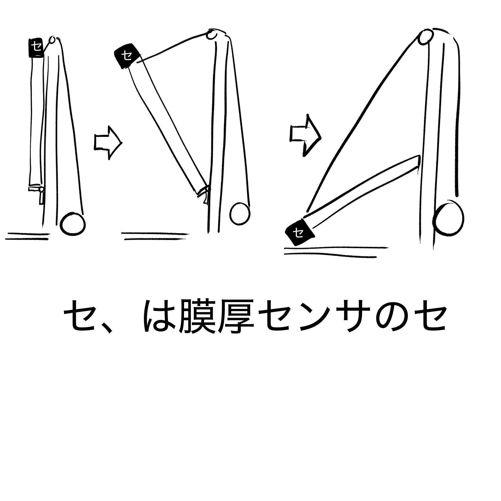

# 測定機構の案（検討メモ）

**spec ではない。**2026-10-30 にユーザーが示した「いま考えている機構」の記録。
決まったものから [Spec.md](spec/Spec.md)・[Spec-open.md](spec/Spec-open.md) へ移す。

> **機構は開発中で、構成機器（サーボ・ボールネジ等）は変わりうる**（2026-10-30 ユーザー。`FD-6`）。
> 詳細設計では機器ごとの違いを薄い層に閉じ込め、機器を替えても判定ロジックと画面を作り直さずに済むようにする。

## 結論（現時点の案）

**跳ね橋のような腕で測定器を前に出し、天面に垂直に押し当てる。**

（スケッチの「セ」は膜厚センサ＝測定器。原画はユーザーの手元 `~/ドキュメント/MIRS/fig/image.jpg`）

| 段 | 動き | 使う機構（案） |
| --- | --- | --- |
| 1. 収納 | 腕は柱に沿って縦に畳まれ、測定器は腕の上端にある | — |
| 2. 前に出す | 腕の下端を支点に、上端を前へ倒す。柱の上端から腕の先へ張った線で角度を保つ（跳ね橋） | 腕を倒す駆動（未定） |
| 3. 天面へ近づける | 腕を水平より下まで倒し、先端を天面に近づける。**近づける間ずっと、測定器を天面に垂直に保つ** | 先端の**サーボ** |
| 4. 接触させる | 最後に測定器を天面へまっすぐ押し出して接触させる | **ボールネジ** |

## 決まっていること（ユーザー発言そのまま）

- 測定器は**垂直に押し当てることで測定できる**
- **まず天面の測定を目指す**
- 測定器は高価で購入できないので、**モックアップで再現する**。再現するのは**概形と接触の検知**。測定値は「値を保存しました」で済ませる
- **製品に触れるのは測定器だけ**。腕など測定器以外は製品に当てない

## スケッチから読み取れず、決まっていないこと

| 問い | 関係 |
| --- | --- |
| 柱は hve-system の昇降機か、測定専用の柱か。円（柱の下・右）は何か | [Spec-open.md](spec/Spec-open.md) `FK-A5` |
| 腕を倒す駆動は何か（線を巻き取るモータ・支点のモータ） | 詳細設計 |
| 天面の高さに対して、腕の支点をどの高さに置くか（昇降で合わせるのか） | `FK-V1` |
| 「垂直」をどう知るか（腕の角度から計算・傾きセンサ・天面を見る） | 詳細設計 |
| 接触したことをどう検知するか（モックアップでも要る）、どれだけの力で押すか | `FK-X4`・`FK-V3` |

## 次にやること

1. `FK-A5`（機構をどこに載せ、誰が駆動するか）を決める
2. モックアップの概形（寸法）と接触の検知の方法を決める
3. 天面の高さ・届く距離・押し当ての力を測る／先方に聞く（`FK-V1`）
